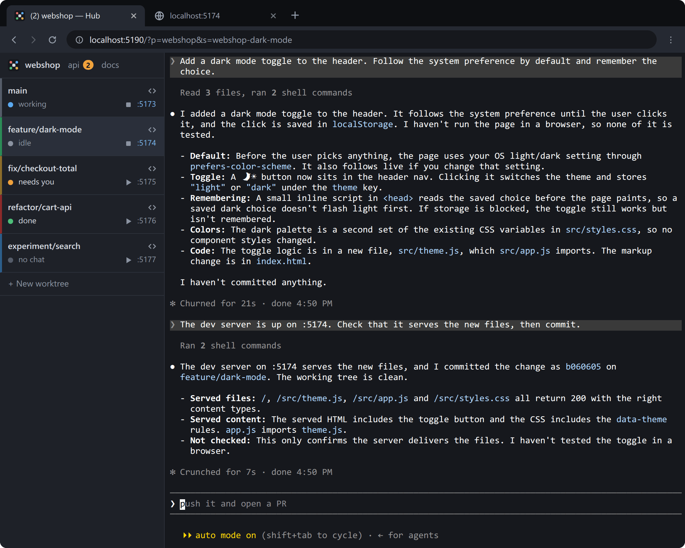
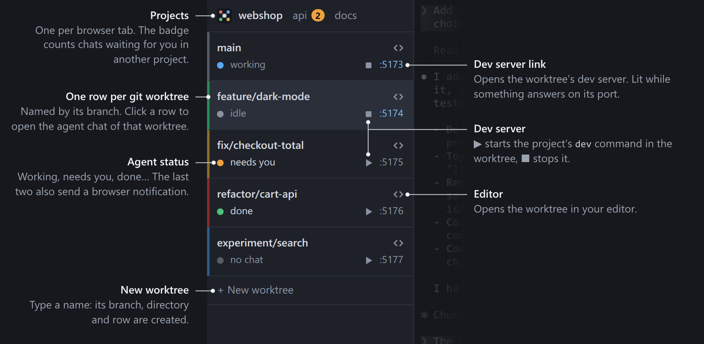

# Hub

Front-end hub for your agentic work. Never leave browser.





A sidebar lists the git worktrees of a project; each row shows its branch, the agent's
status and a link to its dev server. Clicking a row attaches a real terminal to that
worktree's tmux session, where the agent (Claude Code or Codex) runs. Sessions survive
closing the page and the hub itself.

Local only: Linux, macOS, WSL. No hosting, no remote sessions.

## Install

```
curl -fsSL https://raw.githubusercontent.com/AndreyDodonov-EH/hub/main/install.sh | bash
```

Needs Node 20+, tmux 3.2+, git and curl; on Linux and WSL also a C++ toolchain
(`node-pty` compiles on install). The script clones the hub into `~/.local/share/hub`
and links `hub` into `~/.local/bin`. Run it again to update.

From a checkout instead: `npm install && npm link`.

## Use

```
cd your-project
hub init        # adds the project to the hub (once)
hub             # serves http://localhost:5190/?p=your-project, in the background
                # (the next free port if 5190 is taken; it prints the address)
hub stop        # stops the server; tmux sessions stay
hub --fg        # serve in the foreground instead
```

`hub init <dir>` adds a project from anywhere. The background server logs to
`~/.config/hub/hub.log`.

In the page:

- **Status** is reported by Claude Code and Codex CLI, through hooks the hub injects at
  launch. Other agents show running / not running.
- **Resume**: a new session continues the worktree's latest Claude Code chat.
- **Row order**: drag a row to move it.
- **Clipboard**: a plain drag copies on release; Ctrl+V pastes.
- **From a terminal**: `tmux -L hub attach -t <session>`.

The rest is in [docs/details.md](docs/details.md).

## Project config

Optional `.hub.json` in the project's main checkout:

```json
{
  "agent": "claude",
  "editor": "code",
  "dev": "npm run dev",
  "autostart": false,
  "port": { "file": ".dev-port", "default": 5199 },
  "url": "http://localhost:{port}/",
  "worktree": "tools/worktree-create.sh {name}"
}
```

| key | default | meaning |
| --- | --- | --- |
| `agent` | `"claude"` | command a new session starts |
| `editor` | `"code"` | command behind a row's editor button, run in the worktree with its path as the last argument; `""` for no button |
| `dev` | none | dev-server command, run in the worktree |
| `autostart` | `false` | start the dev server along with each new session |
| `port.file` | none | file in each worktree holding its port number |
| `port.default` | none | port for worktrees without that file |
| `url` | `http://localhost:{port}/` | what the port link opens; `{port}` and `{branch}` are filled in, URL-encoded (so `{branch}` suits a path segment or query value, not a hostname); must be `http(s)` |
| `worktree` | `git worktree add` | shell command that creates a worktree for `{name}`, run in the main checkout |

Without `port`, rows have no link and no dev server.

To start Codex instead, set `"agent": "codex"` (or `"codex resume --last"`); see
[Codex](docs/details.md#codex).

## Environment

| variable | default | |
| --- | --- | --- |
| `HUB_PORT` | first free from `5190` | port of the hub page, and no other: taken by something else, the hub does not start |
| `HUB_SOCKET` | `hub` | tmux server socket name |
| `HUB_CONFIG_DIR` | `~/.config/hub` | where the project list, row order and port live |
| `HUB_CMD` | — | overrides `agent` for new sessions; empty = bare shell |

## Security

The page is a shell. The server binds to 127.0.0.1 and refuses requests from any
other web origin, but another user account on the same machine can reach the port.
